<picture>
  <source media="(prefers-color-scheme: dark)" srcset="assets/header-dark.svg" />
  
</picture>

  🇻🇳 Minecraft plugin developer from Hanoi — I build Paper plugins, server tooling and the
  <a href="https://github.com/auroravnliems/TachyonScript"><b>TachyonScript</b></a> language, and run the <b>ASGNetwork</b> server ecosystem.
   
  Vietnamese (native) · English (fluent) · most work lives in private repos, but I'm always reachable

  
  
  
  

## 🧰 Stack

| Area | Tech |
| :-- | :-- |
| **Languages** |      |
| **Minecraft** |        |
| **Infra** |      |
| **Tools** |     |

**Focus:** Paper plugins & API design · bytecode patching · license enforcement & obfuscation · Pterodactyl/Docker hosting & DDoS mitigation 
**Learning:** advanced ASM, Kotlin coroutines & DSLs, multi-node Pterodactyl

## 🚀 Projects

| Project | What it is | Links |
| :-- | :-- | :-- |
| ⭐ **TachyonScript** | Scripting language for Minecraft servers — build server features without touching Java | [GitHub](https://github.com/auroravnliems/TachyonScript) · [BuiltByBit](https://builtbybit.com/resources/tachyonscript-the-ultimate-script.133106/) · [Modrinth](https://modrinth.com/plugin/tachyonscript) |
| 🔒 **AuroraSecurity** | Advanced security plugin — license enforcement, anti-piracy | [BuiltByBit](https://builtbybit.com/resources/aurorasecurity-advanced-security-plugin.112156/) |
| 👑 **AuroraKOTH** | Complete King of the Hill event plugin | [BuiltByBit](https://builtbybit.com/resources/aurorakoth-the-ultimate-koth-plugin.112933/) |
| ⚔️ **AuroraCombat** | PvP management — combat tag, PvP toggle, newbie protection, item cooldowns, kill rewards. Paper 1.21.1+ / Folia | [GitHub](https://github.com/auroravnliems/AuroraCombat) |
| 🌙 **LunaClient** | Minecraft launcher for the community, Windows & Linux | [luna.asgmc.net](https://luna.asgmc.net) |
| 💳 **AuroraDonate** | Card & bank donation system with GUI management and per-method reward rates | [Discord](https://dsc.gg/auroravn) |
| 🔍 **AuroraItemInfo** | In-game inspector for MMOItems stats, Nexo metadata and custom NBT | [Discord](https://dsc.gg/auroravn) |
| 📢 **AuroraPunishNotify** | CMI punishments → Discord webhook for staff | [GitHub](https://github.com/auroravnliems/AuroraPunishNotify) |
| 🛠️ **AuroraMMOSkills** | mcMMO fork with a custom GUI module and survival-specific progression | [Discord](https://dsc.gg/auroravn) |

🌍 **ASGNetwork** — Leaf 1.21.x on Pterodactyl · TCPShield + iptables DDoS mitigation · Cloudflare-proxied panel · Terra worlds (Origen, Tartarus, ReimagEND)

## 📊 Activity

<picture>
  <source media="(prefers-color-scheme: dark)" srcset="assets/stats-dark.svg" />
  
</picture>

<picture>
  <source media="(prefers-color-scheme: dark)" srcset="assets/langs-dark.svg" />
  
</picture>

<picture>
  <source media="(prefers-color-scheme: dark)" srcset="https://raw.githubusercontent.com/auroravnliems/auroravnliems/output/profile-3d-contrib/profile-night-rainbow.svg" />
  
</picture>

---

  Bugs & feature requests → the issue tracker of each repo · Server & business → <a href="https://dsc.gg/auroravn">Discord</a>
   
  Commercial plugins are proprietary, source-available; open-source repos follow their own licenses. Security and obfuscation research is for legitimate plugin protection only.

